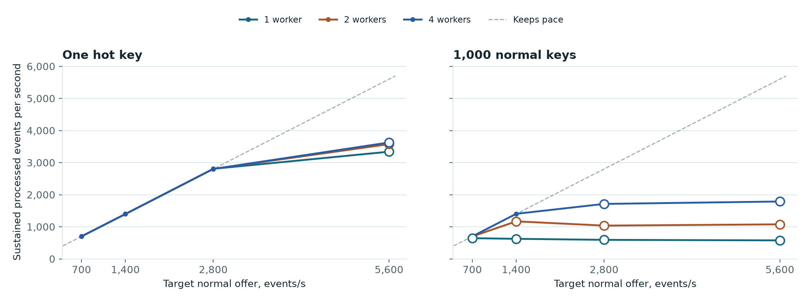

# Alert Funnel — Flexible Alerting & Notification Service

Team workspace for the 2026 Goldman Sachs Warsaw Hackathon (Software Engineering track).

This local integration runs the React frontend, ingestion, rule workers, delivery services and simulators together. Start it from the repository root with Docker Desktop or Docker Compose.

```sh
docker compose up -d --build --wait
```

If you already have a database volume from `main`, use the same command. The
`db-upgrade` service applies the config registry and log checkpoint migrations
in one transaction before the API and workers start. Repeated runs preserve
existing events, rules and audit history. To check the upgrade, run
`docker compose logs db-upgrade`.

Open the frontend on port 5173 and the simulated phone on port 8100. The frontend uses the real API. The local acceptance report includes the browser demonstration, current test results, measured throughput and outage recovery. [Integration report](loadtest/results/dev2-integration/README.md)

### Send a first alert

From the repository root, send the supplied payments event. The demo clock puts Anna inside her daytime SMS preference in Warsaw.

```sh
curl --fail-with-body -sS http://127.0.0.1:8000/v1/events/generic-webhook \
  -H 'Content-Type: application/json' \
  -H 'X-Api-Key: demo-generic-key' \
  -H 'X-Demo-Clock: 2026-10-23T11:15:00+02:00' \
  --data-binary @fixtures/events/alertmanager_high_error_rate.json
```

Copy the first ID from `event_ids` into `GET /v1/events/<id>/explain`. Once processing finishes, look for the `anna-payments-critical` decision and the notification for `anna` on `sms`. The simulated phone records the delivery. [Example event](fixtures/events/alertmanager_high_error_rate.json)

## Performance and scalability

### Throughput and latency

We completed **24 Docker saturation runs** on source commit `ae69a28` with 24 Docker vCPUs and 31.06 GiB of Docker memory. Each run scheduled 700, 1,400, 2,800 or 5,600 normal RabbitMQ events/s for 60 seconds, plus two critical events/s. We tested one hot alert key and 1,000 distinct keys with one, two and four normal rule workers. End-to-end latency includes broker wait and ends at the simulated SMS or phone receiver. [Machine and images](loadtest/results/saturation-ae69a28/machine.json)

| Normal rule workers | First growing backlog with one hot key | First growing backlog with 1,000 keys |
|---:|---:|---:|
| 1 | 5,600/s | 700/s |
| 2 | 5,600/s | 1,400/s |
| 4 | 5,600/s | 2,800/s |

The single-key workload kept up at the tested rate of **2,800 normal events/s**. With 1,000 keys and four rule workers, the highest tested rate with a steady inbox was **1,400 normal events/s**. Peak sustained processing in the matrix reached 3,629 events/s with one hot key while backlog was growing. Of 3,782,880 scheduled events, RabbitMQ confirmed 3,775,341. The generator dropped 7,539 at the highest rate. Ingestion rejected zero. [Full results](loadtest/results/saturation-ae69a28/REPORT.md)



At **1,400 normal events/s across 1,000 alert keys**, changing only the normal rule worker count gave these results. The inbox figures are the early and late medians inside the steady load window. [Run metrics](loadtest/results/saturation-ae69a28/runs.csv)

| Normal rule workers | Sustained processed/s | Pending inbox, early → late | Normal p50 / p99 | Critical p50 / p99 |
|---:|---:|---:|---:|---:|
| 1 | 626.0 | 15,790 → 41,995 | 22,565 / 38,499 ms (N=2,000) | 201 / 345 ms (N=240) |
| 2 | 1,170.0 | 6,130 → 14,196 | 25,034 / 42,449 ms (N=2,000) | 207 / 371 ms (N=240) |
| 4 | 1,405.9 | 410 → 384 | 26,689 / 45,547 ms (N=2,000) | 203 / 359 ms (N=240) |

RabbitMQ kept up in all three runs. No generator drops or ingestion rejects occurred, and all 2,240 expected simulated deliveries arrived in each run. Four normal workers kept the rule inbox steady. The burst of first notifications still queued at the shared delivery worker, which is why the normal receiver p99 stayed high. [Stage measurements](loadtest/results/saturation-ae69a28/REPORT.md#bottleneck-evidence)

At a target of 5,600 normal events/s with one hot key, adding a second RabbitMQ intake consumer raised measured ingress from 3,571.0 to 5,546.8 events/s in the repeat. The late-window RabbitMQ queue median fell from 99,609 to 158 while the rule inbox began to grow. The result tells us which stage to scale first for that workload. [Controlled comparison](loadtest/results/saturation-ae69a28/bottleneck-analysis.md)

Six controlled runs repeated the bottleneck checks. In the delivery comparison at 700 normal events/s across 1,000 keys, scaling delivery from one to four workers reduced normal receiver p99 from 39.9 to 33.6 seconds (N=2,000 per run). This measures the notification burst separately from rule throughput. [All controlled runs](loadtest/results/saturation-ae69a28/REPORT.md#controlled-diagnostic-repeats)

Run the same matrix from the repository root with Python 3.12 and Docker Compose.

```sh
docker compose pull postgres rabbitmq mailpit
python loadtest/run_saturation.py --output loadtest/results/saturation-REPEAT
```

The report includes the p50, p95 and p99 with receipt counts, backlog trends, PostgreSQL CPU and lock samples, and the two terminal captures from the same run. [Load-test script](loadtest/run_saturation.py) · [Recorded commands](loadtest/results/saturation-ae69a28/reproduce.txt) · [Evidence checks](loadtest/results/saturation-ae69a28/verification.json)

### How the system can grow

Today, multiple normal rule workers claim separate inbox rows in PostgreSQL. Updates to a single alert key serialize to keep grouping and counts correct. Critical events have a separate rule worker. In the tested setup, both lanes share RabbitMQ intake, a single PostgreSQL instance, and the delivery service. PostgreSQL holds the inbox deduplication keys, configuration, alert counts, delivery status and audit history.

1. **Scale the growing stage.** Track RabbitMQ queue depth, PostgreSQL inbox age and delivery age separately. Increase consumers or workers at the stage with increasing backlog. Run the same workload again and compare throughput, p99, CPU and lock waits.
2. **Partition queues and state as traffic grows.** Give critical traffic its own intake path if the shared queue delays it. Route events by a stable source partition and route rule updates by rule and alert key. Keep each event's deduplication identity and each alert key under one owner so that replays and concurrent workers preserve counts. Batch database work and validate indexes before partitioning durable inbox, alert and outbox state.
3. **Validate larger bursts and more consumers.** Use a one-million-event burst with a stated arrival window and 10,000 active subscriptions as test targets for a replicated broker and database setup. Measure drain time and receiver p99 by priority, including during a restart. Reconcile accepted event IDs and receiver receipts, and test channel quotas and team fairness.

## Team: start here
1. Read [docs/BRIEF.md](docs/BRIEF.md) (what, scope, gates, ownership), then [docs/CONTRACT.md](docs/CONTRACT.md).
2. Read [AGENTS.md](AGENTS.md), then your handoff:
   - Yi — backend core + tech lead: [DEV1-backend-Yi.md](docs/handoff/DEV1-backend-Yi.md) · branch `feat/backend-yi`
   - daizhongtian — data & platform: [DEV2-data-daizhongtian.md](docs/handoff/DEV2-data-daizhongtian.md) · branch `feat/data-daizhongtian`
   - zhaoqinghe — frontend: [DEV3-frontend-zhaoqinghe.md](docs/handoff/DEV3-frontend-zhaoqinghe.md) · branch `feat/frontend-zhaoqinghe`
   - Marlon — review & presentation (from G3): [DEV4-review-Marlon.md](docs/handoff/DEV4-review-Marlon.md) · branch `feat/review-marlon`
3. `git switch <your branch>`. Never push to `main`; open a PR.
4. Run the base:
   ```bash
   cp .env.example .env          # add ANTHROPIC_API_KEY locally if you work on an assist feature
   make infra                    # postgres + rabbitmq + mailpit (docker)
   cd backend && uv sync && cd ..
   make test                     # scaffold tests must stay green
   make api                      # http://localhost:8000/health
   ```
5. Record gate results in [docs/GATES.md](docs/GATES.md) (PASS / FAIL / NOT_RUN).

## Layout
```
config/            sources, schemas, rules, teams/preferences, runbooks (hot-reloaded)
fixtures/events/   Appendix A sample events (+ a pricing log file)
fixtures/golden/   black-box acceptance cases derived from the task text
fixtures/api/      mock API responses for UI work
db/migrations/     001 shared; 1xx Yi, 2xx daizhongtian
backend/alerting/  contracts.py, llm.py, templates.py, clock.py, db.py (shared) + ingest/ schemas/ config/ rules/ routing/ delivery/ runbooks/ assist/ api/
mocks/             fake_telecom, mock_ops (daizhongtian)
loadtest/          golden runner, load/chaos reports (daizhongtian)
frontend/          React app (zhaoqinghe)
```

## Local URLs
API `:8000` · UI `:5173` · Mailpit `:8025` · RabbitMQ `:15672` · fake-telecom `:8100` · mock-ops `:8200`
