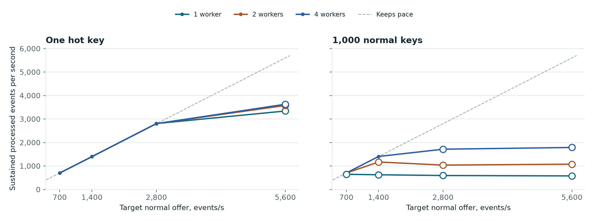
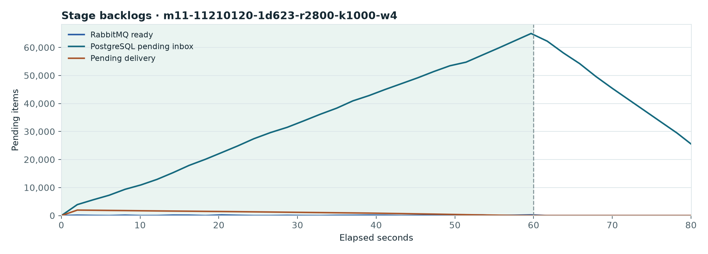
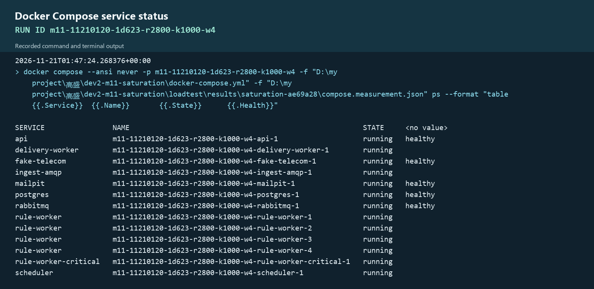
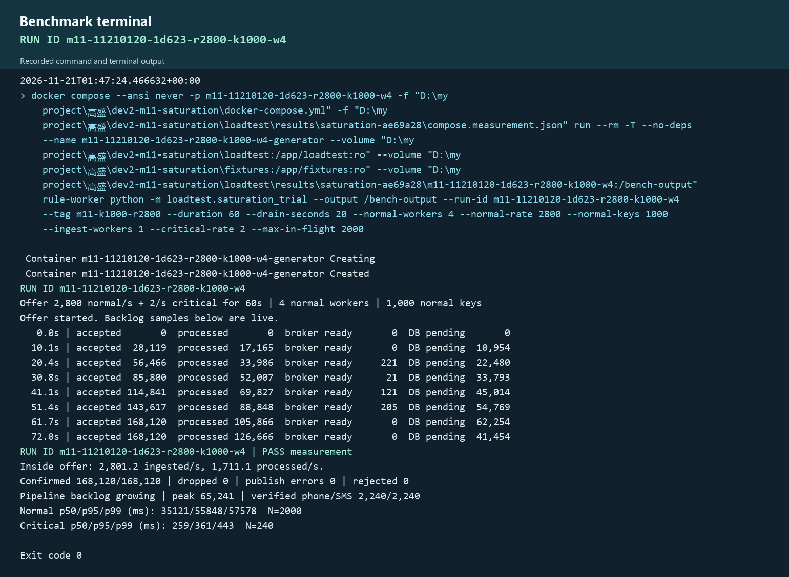

# Alert Funnel saturation benchmark

Batch **m11-11210120-1d623** · source **ae69a2829f7e** · 24 PASS, 0 FAIL, 0 NOT_RUN.
Run status describes measurement and evidence collection. Capacity and delivery outcomes are shown below.

The verified runs scheduled **3,782,880 synthetic events** across RabbitMQ. The highest measured sustained processing rate was **3,629 events/s** with 4 normal workers and 1 normal alert keys. The throughput and latency figures come from the running stack and simulated receivers.

RabbitMQ confirmed 3,775,341 events. The generator dropped 7,539, the publisher reported 0 errors, and ingestion rejected 0 events. Each run uses a bounded observation window. A broker-confirmed event still waiting at the final snapshot is tracked as pending.

## Throughput and the saturation knee



| Normal workers | First rising backlog, one hot key | First rising backlog, 1,000 keys |
|---:|---:|---:|
| 1 | 5,600/s | 700/s |
| 2 | 5,600/s | 1,400/s |
| 4 | 5,600/s | 2,800/s |

A knee is the first tested normal offer where pipeline backlog grows by more than a quarter second of scheduled traffic between both adjacent block medians, with a minimum threshold of 20 items. The three blocks cover the offer window after warm-up. Pipeline backlog adds RabbitMQ messages ready for consumption to pending PostgreSQL inbox rows. RabbitMQ deliveries already assigned to a consumer sit outside this count.

## Bottleneck evidence

The limiting stage depended on the workload. Distributed alert keys filled the PostgreSQL rule inbox. At the highest single-key offer, a second RabbitMQ intake consumer cut the broker's late-window queue median from 99,609 to 158 messages and moved the growing backlog into the rule inbox.

### Rule processing with 1,000 keys

At 1,400 normal events/s, RabbitMQ confirmed all 84,120 scheduled events inside the offer for each worker count, and the median broker queue was zero throughout. With one normal rule worker, sustained processing was 626.0 events/s, and the PostgreSQL inbox medians rose from 15,790 to 29,540 to 41,995. Scaling to four workers raised processing to 1,405.9 events/s, with inbox medians of 410, 350.5 and 384. Mean PostgreSQL CPU rose from 78.1% to 166.1%. At 2,800 normal events/s, even four workers saw inbox medians rise from 20,101 to 39,648 to 56,041 while the RabbitMQ medians stayed below 102. [Matrix run summaries](batch.json)

A fresh one-versus-four comparison at 1,400 normal events/s used the same workload hash. It reproduced 630.0 and 1,404.8 sustained events/s, respectively. Late-window inbox medians were 41,106 and 350.5. All 84,120 event submissions were broker-confirmed in both runs. [Rule worker repeat](diagnostic-rules/batch.json)

### Broker intake at the highest single-key offer

With four normal rule workers and a target of 5,600 normal events/s, we repeated the same scheduled workload with one and two RabbitMQ intake consumers. RabbitMQ confirmed 330,570 and 332,880 events inside the offer window, respectively. Ingested throughput rose from 3,571.0 to 5,546.8 events/s. RabbitMQ queue medians went from 32,442 / 65,948 / 99,608.5 with one intake consumer to 105 / 0 / 157.5 with two. With the second consumer, the pending rule inbox grew from a median of 29,120 to 88,160.5, and sustained processing reached 3,782.0 events/s. The queue change locates the first limit in the RabbitMQ-to-inbox path and reveals the next limit in rule processing. [One intake consumer](diagnostic-intake1/batch.json) · [Two intake consumers](diagnostic-intake2/batch.json)

Critical receiver p99 moved from 28,449 ms (N=206) to 1,233 ms (N=238) in those runs. Each run targeted 120 critical events and expected 240 SMS and phone receipts. Observations ended after a bounded drain window. Mean PostgreSQL CPU rose from 107.6% to 139.7%, and sampled active advisory-lock waits rose from 8 to 69. The samples show more recorded lock contention alongside the inbox backlog. Query-level profiling would identify which statements account for that time. [Intake comparison and lock observations](diagnostic-intake2/m11-11210202-ea57d-r5600-k1-w4/samples.json)

### Notification delivery after the alert is created

At 700 normal events/s across 1,000 keys with four rule workers, we changed the delivery worker count from one to four and kept the scheduled workload hash. The rule inbox stayed steady in both runs, with 701.3 and 702.7 sustained events/s. Normal receiver p99 improved from 39,877 to 33,627 ms (N=2,000 each). The middle-block delivery queue median went from 407.5 to 53. Peak delivery work remained close to 1,900 items as the first alerts arrived in a burst. All 2,240 expected simulated receipts arrived in each run. [One delivery worker](diagnostic-delivery1/batch.json) · [Four delivery workers](diagnostic-delivery4/batch.json)

Run **m11-11210120-1d623-r2800-k1000-w4** observed 1,714 sustained events/s, a peak pipeline backlog of 65,241, and 2,240 verified receipts. The separate stage curves locate where the work accumulated.



| Worker, key shape and offer | RabbitMQ ready medians | PostgreSQL pending medians | Delivery pending medians | PostgreSQL CPU mean / peak | Lock-wait session samples |
|---|---:|---:|---:|---:|---:|
| 1 · One hot key · 5,600/s | 30,166 / 60,270 / 90,395 | 8,298 / 17,716 / 25,080 | 0 / 0 / 0 | 99.3% / 122.5% | 0 |
| 2 · One hot key · 5,600/s | 32,556 / 66,104 / 100,204 | 400 / 400 / 400 | 0 / 0 / 0 | 115.8% / 145.5% | 7 |
| 4 · One hot key · 5,600/s | 32,030 / 64,532 / 98,932 | 400 / 400 / 300 | 0 / 0 / 0 | 115.1% / 151.9% | 7 |
| 1 · 1,000 normal keys · 700/s | 0 / 0 / 0 | 2,765 / 3,952 / 4,775 | 1,196 / 195 / 0 | 75.6% / 107.6% | 0 |
| 2 · 1,000 normal keys · 1,400/s | 0 / 0 / 0 | 6,130 / 10,245 / 14,196 | 1,313 / 494 / 0 | 128.3% / 181.1% | 0 |
| 4 · 1,000 normal keys · 2,800/s | 16 / 79 / 102 | 20,101 / 39,648 / 56,040 | 1,505 / 978 / 270 | 221.7% / 294.7% | 0 |

### Controlled diagnostic repeats

| Run ID | Ingest / rule / delivery workers | Keys | Offered/s | Ingested/s | Sustained processed/s | Broker confirms in window | Peak pipeline / delivery backlog | Normal p99 | Verdict |
|---|---:|---:|---:|---:|---:|---:|---:|---:|---|
| [m11-11210200-9f20c-r5600-k1-w4](diagnostic-intake1/m11-11210200-9f20c-r5600-k1-w4/summary.json) | 1 / 4 / 1 | 1 | 5,600 + 2 | 3,571 | 3,533.2 | 330,570 | 114,731 / 2 | 226 ms | PASS |
| [m11-11210202-ea57d-r5600-k1-w4](diagnostic-intake2/m11-11210202-ea57d-r5600-k1-w4/summary.json) | 2 / 4 / 1 | 1 | 5,600 + 2 | 5,546.8 | 3,782 | 332,880 | 102,975 / 2 | 350 ms | PASS |
| [m11-11210204-82ce5-r1400-k1000-w1](diagnostic-rules/m11-11210204-82ce5-r1400-k1000-w1/summary.json) | 1 / 1 / 1 | 1,000 | 1,400 + 2 | 1,402 | 630 | 84,120 | 47,000 / 1,832 | 39,968 ms | PASS |
| [m11-11210204-82ce5-r1400-k1000-w4](diagnostic-rules/m11-11210204-82ce5-r1400-k1000-w4/summary.json) | 1 / 4 / 1 | 1,000 | 1,400 + 2 | 1,402 | 1,404.8 | 84,120 | 1,520 / 1,932 | 51,981 ms | PASS |
| [m11-11210207-34c2d-r700-k1000-w4](diagnostic-delivery1/m11-11210207-34c2d-r700-k1000-w4/summary.json) | 1 / 4 / 1 | 1,000 | 700 + 2 | 702 | 701.3 | 42,120 | 210 / 1,917 | 39,877 ms | PASS |
| [m11-11210208-ba9e8-r700-k1000-w4](diagnostic-delivery4/m11-11210208-ba9e8-r700-k1000-w4/summary.json) | 1 / 4 / 4 | 1,000 | 700 + 2 | 702 | 702.7 | 42,120 | 211 / 1,899 | 33,627 ms | PASS |

## Measured runs

The processing column below covers only the 60-second offer. The figure uses the sustained rate after warm-up. The latency columns show p50 / p95 / p99 in milliseconds and receipt counts.

| Normal keys | Workers | Target normal/s | Broker confirms/s | Ingested/s | Processed/s | Normal latency (ms) | Critical latency (ms) | Peak pending | Dropped / errors / rejected | Trend |
|---:|---:|---:|---:|---:|---:|---|---|---:|---:|---|
| 1 | 1 | 700 | 702 | 702 | 699.6 | 220 / 235 / 235 (N=2) | 234 / 336 / 386 (N=240) | 173 | 0 / 0 / 0 | no sustained growth |
| 1 | 1 | 1,400 | 1,402 | 1,402 | 1,399 | 358 / 371 / 371 (N=2) | 236 / 422 / 476 (N=240) | 351 | 0 / 0 / 0 | no sustained growth |
| 1 | 1 | 2,800 | 2,802 | 2,802 | 2,795 | 445 / 462 / 462 (N=2) | 287 / 677 / 759 (N=240) | 661 | 0 / 0 / 0 | no sustained growth |
| 1 | 1 | 5,600 | 5,602 | 3,830.5 | 3,344.7 | 271 / 289 / 289 (N=2) | 12,607 / 23,712 / 25,654 (N=214) | 132,717 | 0 / 0 / 0 | growing |
| 1 | 2 | 700 | 702 | 702 | 701.4 | 325 / 339 / 339 (N=2) | 227 / 355 / 399 (N=240) | 165 | 0 / 0 / 0 | no sustained growth |
| 1 | 2 | 1,400 | 1,402 | 1,402 | 1,396.2 | 274 / 289 / 289 (N=2) | 238 / 434 / 479 (N=240) | 280 | 0 / 0 / 0 | no sustained growth |
| 1 | 2 | 2,800 | 2,799.7 | 2,799.7 | 2,793.7 | 235 / 250 / 250 (N=2) | 284 / 668 / 739 (N=240) | 640 | 0 / 0 / 0 | no sustained growth |
| 1 | 2 | 5,600 | 5,589.3 | 3,603.6 | 3,597 | 398 / 427 / 427 (N=2) | 13,615 / 27,420 / 28,735 (N=204) | 117,025 | 761 / 0 / 0 | growing |
| 1 | 4 | 700 | 702 | 702 | 700.2 | 226 / 239 / 239 (N=2) | 236 / 347 / 372 (N=240) | 119 | 0 / 0 / 0 | no sustained growth |
| 1 | 4 | 1,400 | 1,402 | 1,402 | 1,397.3 | 271 / 286 / 286 (N=2) | 251 / 440 / 477 (N=240) | 349 | 0 / 0 / 0 | no sustained growth |
| 1 | 4 | 2,800 | 2,802 | 2,802 | 2,795.2 | 382 / 396 / 396 (N=2) | 292 / 592 / 791 (N=240) | 570 | 0 / 0 / 0 | no sustained growth |
| 1 | 4 | 5,600 | 5,587.4 | 3,652.8 | 3,638.2 | 302 / 319 / 319 (N=2) | 14,025 / 26,436 / 27,287 (N=210) | 114,153 | 520 / 0 / 0 | growing |
| 1,000 | 1 | 700 | 702 | 702 | 617.1 | 21,431 / 35,374 / 36,394 (N=2,000) | 190 / 318 / 383 (N=240) | 5,050 | 0 / 0 / 0 | growing |
| 1,000 | 1 | 1,400 | 1,402 | 1,402 | 596.6 | 22,565 / 37,481 / 38,499 (N=2,000) | 201 / 319 / 345 (N=240) | 47,920 | 0 / 0 / 0 | growing |
| 1,000 | 1 | 2,800 | 2,802 | 2,802 | 568.6 | 24,475 / 41,962 / 43,300 (N=2,000) | 235 / 336 / 432 (N=240) | 133,200 | 0 / 0 / 0 | growing |
| 1,000 | 1 | 5,600 | 5,598 | 3,638.7 | 554.6 | 25,727 / 43,592 / 45,377 (N=2,000) | 14,182 / 26,369 / 27,437 (N=208) | 301,401 | 240 / 0 / 0 | growing |
| 1,000 | 2 | 700 | 702 | 702 | 699.1 | 45,504 / 60,193 / 61,134 (N=2,000) | 202 / 358 / 437 (N=240) | 630 | 0 / 0 / 0 | no sustained growth |
| 1,000 | 2 | 1,400 | 1,402 | 1,402 | 1,135.5 | 25,034 / 41,309 / 42,449 (N=2,000) | 207 / 343 / 371 (N=240) | 15,841 | 0 / 0 / 0 | growing |
| 1,000 | 2 | 2,800 | 2,802 | 2,802 | 1,027.9 | 26,673 / 46,778 / 48,242 (N=2,000) | 238 / 369 / 387 (N=240) | 105,245 | 0 / 0 / 0 | growing |
| 1,000 | 2 | 5,600 | 5,565.3 | 3,501.5 | 1,057.9 | 28,957 / 49,275 / 50,735 (N=2,000) | 14,863 / 27,717 / 28,604 (N=202) | 268,546 | 2,201 / 0 / 0 | growing |
| 1,000 | 4 | 700 | 702 | 702 | 700.2 | 22,160 / 36,378 / 37,348 (N=2,000) | 191 / 318 / 371 (N=240) | 246 | 0 / 0 / 0 | no sustained growth |
| 1,000 | 4 | 1,400 | 1,402 | 1,402 | 1,396.2 | 26,689 / 44,226 / 45,547 (N=2,000) | 203 / 299 / 359 (N=240) | 691 | 0 / 0 / 0 | no sustained growth |
| 1,000 | 4 | 2,800 | 2,802 | 2,801.2 | 1,711.1 | 35,121 / 55,848 / 57,578 (N=2,000) | 259 / 361 / 443 (N=240) | 65,241 | 0 / 0 / 0 | growing |
| 1,000 | 4 | 5,600 | 5,538.4 | 3,096.9 | 1,784.4 | 34,295 / 58,233 / 59,842 (N=2,000) | 17,240 / 33,411 / 34,156 (N=180) | 224,837 | 3,817 / 0 / 0 | growing |

Short runs with one hot key produce few ordinary receipts because the rule groups them into one alert. Its percentiles therefore describe those individual receipts. A receipt still pending when the bounded observation ended is shown as unverified, with no delay estimated.

## Terminal evidence

Both images below use run ID **m11-11210120-1d623-r2800-k1000-w4**. They render the captured terminal text. The unabridged [Compose output](m11-11210120-1d623-r2800-k1000-w4/compose-ps.txt) and [benchmark output](m11-11210120-1d623-r2800-k1000-w4/benchmark-terminal.txt) are separate files.





## Method and reproduction

- Intel(R) Core(TM) Ultra 9 275HX · 24 Docker vCPUs · 31.06 GiB Docker memory. Docker 29.9.2. [Machine and image IDs](machine.json)
- Fresh Compose volumes for each run. One critical rule worker, one delivery worker and one RabbitMQ intake consumer in the main matrix. Each proposed normal-worker count was verified in Compose.
- The workload generator assigns stable message IDs and group keys to the fixture. The same workload hashes across normal-worker counts were verified.
- Measure broker confirms and committed events separately. The offer lasts 60 seconds. The observer allows up to 20 more seconds to capture completions. Ingest rates use the source receipt timestamp of committed rows. Processing rates use the rule worker's recorded processing timestamp within the offer or steady window.
- Match notification UUID, channel, recipient and generation timestamp against the phone simulator's receipt ledger. Latency runs from the actual offer timestamp to the receiver timestamp in the same Docker VM, including broker wait. This is measured in each lane independently.
- PostgreSQL CPU is sampled from Docker stats. Roughly 100% is one logical core. Lock waits are counts of active waiting sessions in sampled observations from PostgreSQL, rather than cumulative lock-wait time.
- Recalculate receipt percentiles, event counts and evidence checksums separately. **30/30** raw evidence checks passed. [Verification details](verification.json)

Check out `ae69a2829f7ead5c42107375fb5346046250ec7c`, extract the [exact measurement harness](harness.zip) in the repository root, and run with Docker Desktop, Docker Compose and Python 3.12.

```powershell
docker compose pull postgres rabbitmq mailpit
python loadtest/run_saturation.py --output loadtest/results/saturation-REPEAT
```

The [recorded command](reproduce.txt) and each run's `commands.json` preserve the invocation that produced this report. The repository evidence includes per-run summaries, time series, Docker CPU and memory samples, Compose status and terminal output. The representative run's compressed event and receipt ledger is also available. [All run metrics](runs.csv) · [Representative raw ledger](m11-11210120-1d623-r2800-k1000-w4/observations.json.gz)
